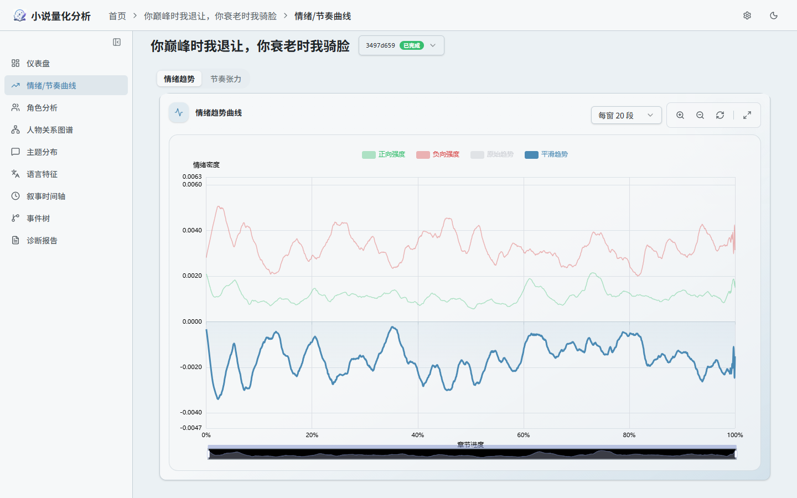
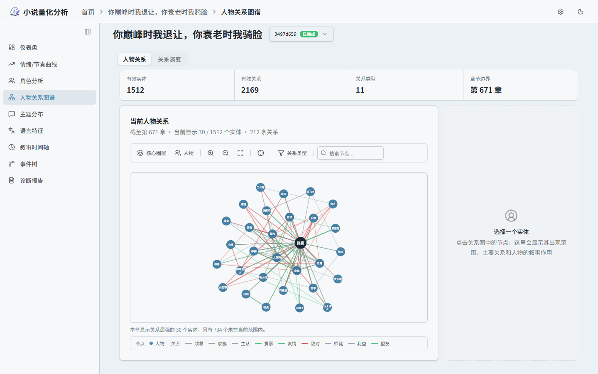
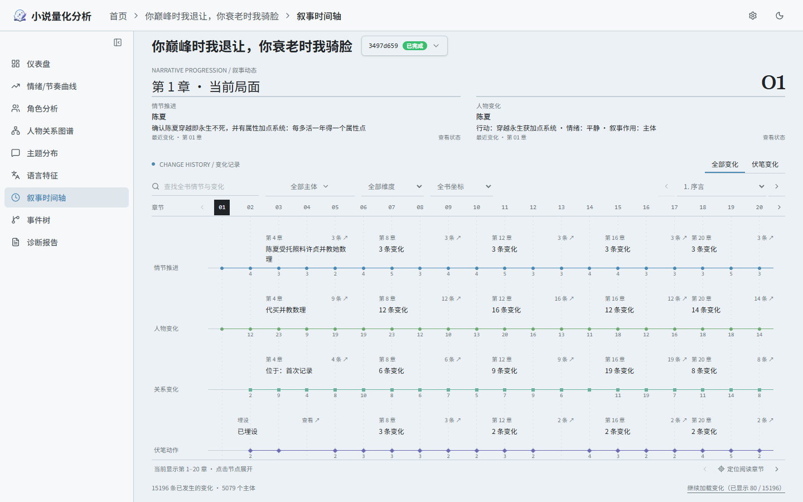
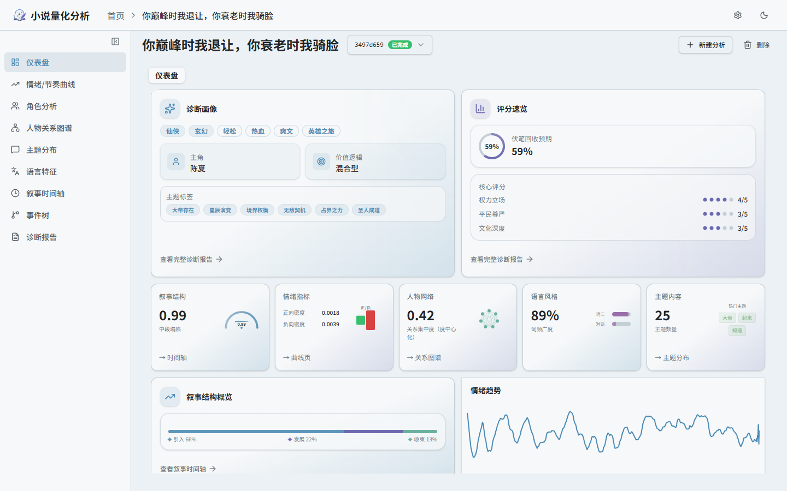
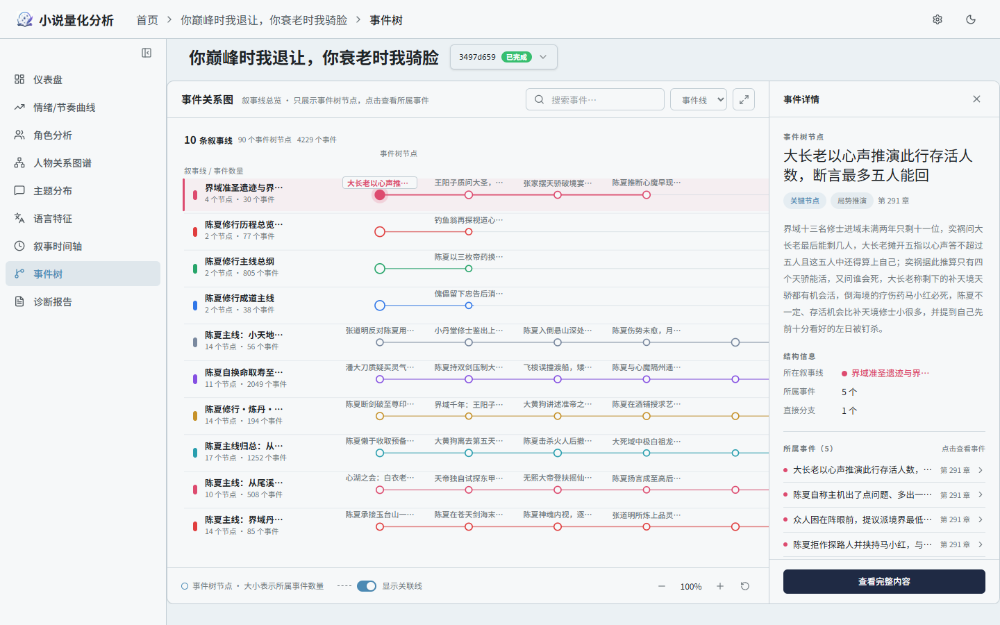
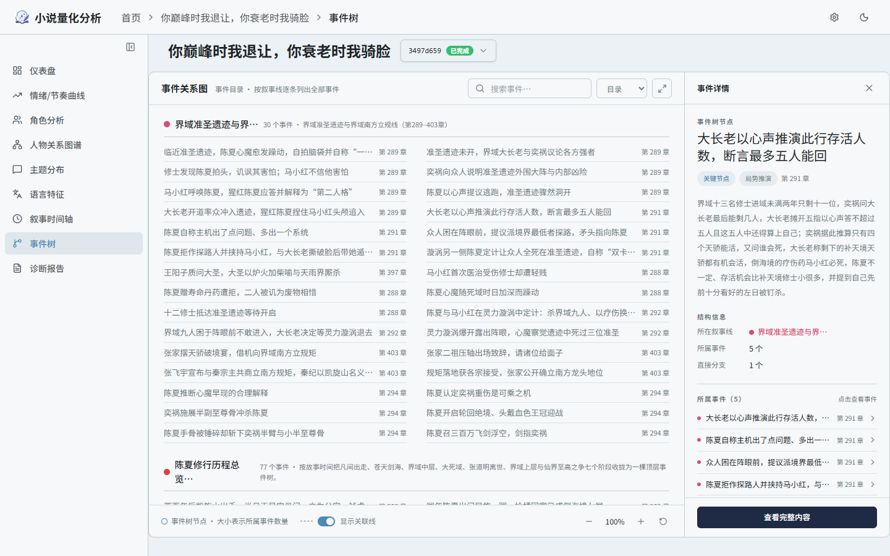

# NovelIQ

> [English](README_EN.md)


[](LICENSE)

对中文网络小说做量化分析的平台：上传一本 txt 全本，六阶段流水线自动完成全书分析。LLM 逐章标注人物、对话、关系、事件与伏笔，配合本地语言模型产出多维指标，最终汇成一组可视化视图与诊断报告。分析在后台运行、逐阶段落库，中断或取消后可从断点继续。

分析完成后，前端提供：

- **仪表盘**：评分速览、维度指标、叙事结构、曲线预览与诊断摘要
- **情感 / 节奏曲线**：情绪趋势按窗口聚合，节奏张力按段落平滑；全书曲线，窗口粒度与缩放可调
- **角色分析**：角色出场强度、叙事职责与焦点排序，展示人物弧线与情绪
- **人物关系图谱**：标注 Agent 逐章记录人物与关系，跨章合并成网络，力导向图浏览，可按人物名检索
- **主题分布**：LDA 主题建模，检测主题随情节的迁移
- **语言特征**：词性、句式、词长与依存统计，以及实体、固定表达与词向量聚合
- **叙事时间轴**：情节变化与角色状态沿全书进度呈现，可切换阅读截点与显示窗口
- **事件树与事件线**：事件线视图按叙事线展示关键节点，点击节点查看其覆盖事件；目录按叙事线列出全部事件，详情可查原文依据
- **诊断报告**：LLM 基于全书取证生成综合诊断；伏笔追踪独立查询线索状态与章节依据

| 情绪/节奏曲线 | 人物关系图谱 |
| --- | --- |
|  |  |
| **叙事时间轴** | **仪表盘** |
|  |  |

| 事件线视图 | 事件目录 |
| --- | --- |
|  |  |

技术栈：Python 3.12 / FastAPI / SQLAlchemy / PostgreSQL 17（pgvector）；React 19 / Vite / ECharts / Tailwind CSS。LLM 走 OpenAI 兼容接口（自建服务或第三方 API 均可），词法分析与词向量为本地离线模型。

## 快速开始

### 前置：离线模型

LTP 与 Word2Vec 从本地加载，**不会自动联网下载**，均可经设置启停：

- **LTP**（`linguistic.ltp.enabled`，默认开启）：完整离线模型目录，路径经 `LTP_MODEL_DIR` 环境变量配置。开启但模型缺失时，分析在「语言结构」阶段报错；关闭则跳过词法/句法/语义标注
- **Word2Vec**（`linguistic.word2vec.enabled`，默认关闭）：关闭时无需模型；开启后需 `models/word2vec/shared/` 下的转换 `.kv` 主文件；它依赖 LTP 词元，LTP 关闭时跳过，LTP 开启但模型缺失时报错。已有 `.vec`/`.bin`/`.txt` 预训练向量时执行：

  ```powershell
  uv run python -m scripts.convert_word2vec_pretrained
  ```

  默认从 `models/word2vec/pretrained/` 读取，写入 `models/word2vec/shared/`。

`models/` 不进 Git；Docker Compose 会把宿主机该目录挂载到容器 `/app/models`。

**嵌入服务**：`EMBEDDING_MODEL_BASE_URL` / `EMBEDDING_MODEL_ID` / `EMBEDDING_MODEL_KEY` 指向 OpenAI 兼容的嵌入端点（本地 llama-server 或云端 API 均可，向量维度以服务实测输出为准）。查询侧按模型名选择格式：Qwen3-Embedding 自动加官方 instruct 前缀，BGE 及其他模型直发原文；文档侧始终直发原文。更换嵌入模型后段落向量需重新生成。

### Docker 部署（推荐）

```powershell
Copy-Item .env.docker.example .env.docker   # 填入模型 API 密钥
docker compose up -d --build
```

`.env.docker` 的数据库已预置指向 Compose 内置的 Postgres，需要填的只有文本模型（`MODEL_*`）和 Embedding 服务地址；模型目录从宿主机 `./models` 挂载。

- 前端：<http://localhost:18080>
- API 文档：<http://localhost:18080/api/docs>

### 源码运行

需要本地 PostgreSQL 17（含 pgvector 扩展）。

```powershell
./scripts/dev.ps1 setup        # 安装依赖（uv）
Copy-Item .env.example .env    # 填数据库与模型 API 密钥
./scripts/dev.ps1 api --port 8000   # 空库建表并安装领域约束；已有库的结构差异不由启动检查
```

前端另开终端：

```powershell
cd frontend
npm install
npm run dev                    # http://localhost:5173，/api 代理到后端 8000
```

## 系统分层

| 层 | 目录 | 职责 |
| --- | --- | --- |
| API | `src/api/routes`、`src/api/services` | HTTP 接口、结果查询、视图数据与完整结果 JSON 导出 |
| 工作流 | `src/workflows` | 任务生命周期、六阶段编排、恢复与取消 |
| Agent 与领域 | `src/agents`、`src/diagnosis`、`src/fact_graph`、`src/event_trees`、`src/case_pool` | 标注与诊断、事实图、完整事件与事件树、案例办理 |
| 量化分析 | `src/metrics`、`src/linguistic`、`src/topic`、`src/lexicons`、`src/text_processing`、`src/embedding` | 指标、语言结构、主题、词表、文本处理与语义检索 |
| 执行与通知 | `src/work`、`src/model_pool`、`src/audit`、`src/event_bus`、`src/sse` | 工作调度、模型容量与健康分、审计、通知持久化与回放 |
| 基础设施 | `src/config`、`src/utils` | 配置与环境变量、取消与事件引用工具 |
| 存储 | `src/storage` | 30 张业务表、UUIDv7 主键、领域查询模块与读取门面、事务与领域约束 |

任务请求经 API 进入工作流应用服务和阶段编排，由 Agent 与领域模块处理，再经 Storage 保存结果。活动通知统一经过 EventBus，SSE 消费者先持久化再推送，支持游标回放；前端分析工作台展示真实 Agent 执行与模型通信。

项目发布版本只维护在 `pyproject.toml`，健康接口与 OpenAPI 共用这一来源。图与事件树按真实章节身份和章节顺序读取，全书结果按运行身份独立保存。界面仅面向桌面端，时间线与事件树分别维护交互状态。

## 分析流水线


| 阶段 | 入口 | 机制与产出 |
| --- | --- | --- |
| 预处理 | `run_preprocess` | 编码探测、章节切分、章节与段落落库、段落指标与平滑曲线；语义检索开启时一并生成段落向量，后续阶段共享原始段落边界 |
| 标注 | `run_annotate` | 章节工作池调度 annotation 或 entity / event / metric 角色，提取实体、关系、对话、完整事件、伏笔与指标；空正文章节不派发；写入即生效，结束请求触发程序完整性检查，通过后保存 |
| 语言结构 | `run_linguistic` | LTP 词元、依存与语义依存、短语命中和情绪事件；LTP 开启时按设置训练 Word2Vec；以全书自选段标签拟合情绪边界并回写段落分值 |
| 聚合 | `run_aggregate` | 从段落充分统计量汇总全书与章节统计并做质量检查；曲线读取已落库结果，不重算 |
| 主题建模 | `run_topic_model` | LDA 训练与模型持久化，`lda_paragraph_topics` 保存段落主题分布 |
| 诊断 | `run_diagnose` | 按诊断角色取证、办理案例并生成报告；派发受模型池健康分与实际容量约束 |

**恢复与取消**：数据库保存任务状态与各阶段完成事实；续跑保留已保存的标注角色结果。取消、失败与重试沿工作流处理，工作台展示失败摘要、重试和未执行状态。

**并发与程序面**：标注按章节体量选择单角色或 entity / event / metric 职责工作，实际并发由模型池容量决定。模型通过 `execute_code(code)` 在受限解释器中批量读写，变量跨程序保留；程序面只放行白名单模块（json、unicodedata、math、collections、datetime），禁止其他属性访问及文件、网络访问。模型设置支持上下文容量，达到压缩条件时整理会话历史。

## 量化方法

- **曲线与平滑** —— 情绪/节奏曲线以全书进度为轴；后端对窗口聚合序列做 robust LOWESS：tricube 核加权局部线性回归，bisquare 稳健迭代三轮抑制离群段，窗口点数不足时带宽自适应倍增；位置取窗口的字符进度（0–1），权重取窗口 token 数。
- **情绪标尺按书拟合** —— 段落情绪强度由情感词典直接打分（否定词按同句内距离判定作用范围）；标注 Agent 逐章自选情绪段作监督，语言结构阶段用全书段落向量拟合岭回归线性边界并逐段回写分值。监督不足（标签 <2 或全同分值）时保留词典口径、不伪造边界，且跨书口径不同、曲线不可比。
- **主题与转移** —— gensim LDA 保存模型产物与段落主题分布，保留各主题权重；主题迁移取相邻窗口分布的 Jensen-Shannon 散度（以 2 为底，范围 0–1）。
- **叙事阶段、三幕与张力** —— 全局峰/局部峰检测把全书划成引入/发展/高潮/收束四段，并识别主高潮区、按比例与窗口约束选择第一幕边界；张力由五个表层分量合成：战斗词加权命中率、感叹号与问号频率、停顿标点频率、对话字符占比，各分量在 run 内按中位数/MAD 稳健标准化（截断 ±3）后加权平均，再经 sigmoid 映射到 0–1。

## 事实图与案例

标注 Agent 在运行级共享事实图中登记实体、关系、对话和事实。实体引用使用正文名字与大类，读取支持关键词检索、段落语义召回及分页。领域贡献按真实生产 Agent 保存；失败和恢复沿既有贡献、保存确认与回滚链处理。

案例进入统一案例池：标注与诊断用 `push_case` 登记文字案例，没有父树的事件树在保存时按树身份自动登记；`claim_case` 或 `claim_random_case` 独占领取，`submit_case` 提交。一个执行可同时持有多件未提交案例，领取只约束案例办理，不构成事件级锁。案例保存类型、说明、领取与提交状态，业务结果按其实际生产者独立保存。

## 事件树

`event_records` 保存完整事件的标题、问题、概要、类型、状态、章节起止和真实生产者；参与者与原文证据单独保存。标注和诊断共用正式事件身份，章级读取按实际章节边界组织结果，跨章结果保持原有证据来源。

`event_groups` 保存事件树与全书结果节点，树身份独立于事件，空树合法；`event_links` 保存语义关联、树内成员顺序与整树父子引用。事件线在诊断阶段从事件树中选出，并由诊断 Agent 命名（线名以「线」结尾）。桌面事件树提供事件线与目录两种视图：事件线按叙事线展示关键节点及其关联，点击节点可列出该节点覆盖的事件；目录按叙事线逐条列出全部事件；详情在右侧面板，原文依据以弹出阅读器打开；时间线独立展示情节变化与角色状态。

初始化为全新库建表并安装领域约束。常规数据纠错从原始输入重新生成。

## 审计与通知

| 表 | 粒度 | 内容 |
| --- | --- | --- |
| `agent` | 一次真实 Agent 执行 | 运行归属、角色与执行状态 |
| `agent_loop` | 一次真实模型请求 | Agent 回合或独立调用身份、模型、用量、费用、计时与通信文档 |
| `agent_toolcall` | 一次工具调用 | 参数、实际执行参数、响应、回执、错误和耗时 |
| `agent_outbox` | 一条活动通知 | 幂等键、运行与章节路由、实际消息字节和投递时间 |

供应商实报用量与程序估算分别记录。请求、响应和回执文档用于审计与展示；工作台通过持久化通知和回放还原执行过程。

## 许可证

[Apache-2.0](LICENSE)。
