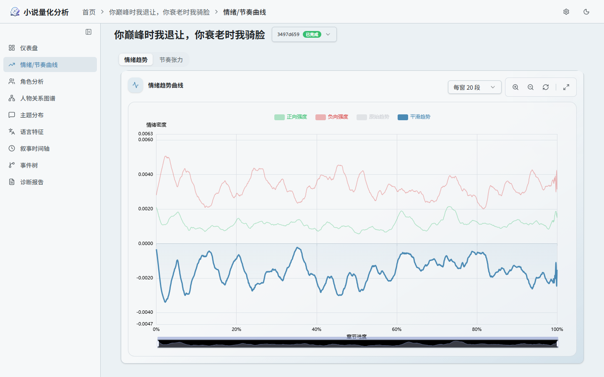
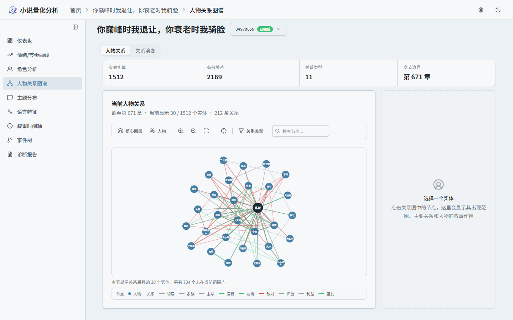
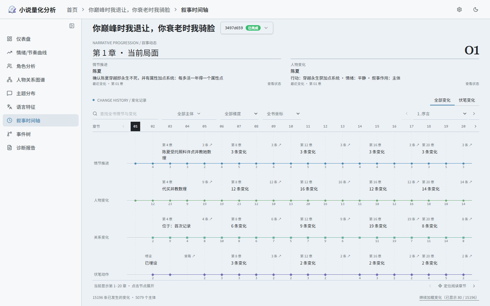
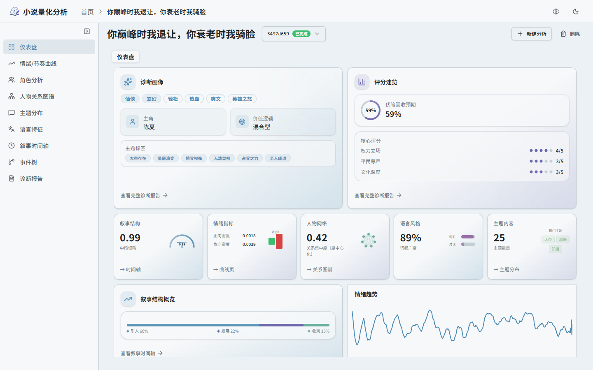
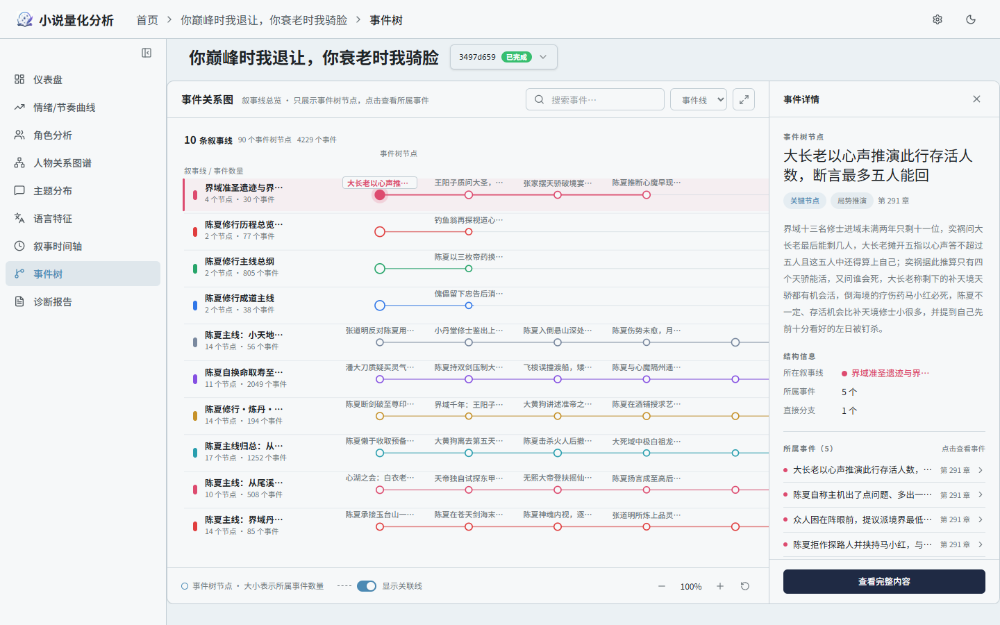
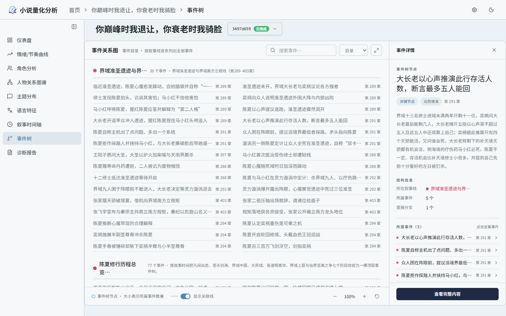
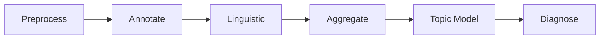

# NovelIQ

> [中文文档](README.md)


[](LICENSE)

A quantitative analysis platform for Chinese web novels: upload a full `.txt` book and a six-stage pipeline analyzes it end to end. An LLM annotates characters, dialogue, relations, events and foreshadowing chapter by chapter, local language models produce multi-dimensional metrics, and everything converges into a set of visual views and a diagnostic report. Analysis runs in the background with each stage persisted as it completes, so interrupted or cancelled runs resume from where they stopped.

Once analysis completes, the frontend provides:

- **Dashboard**: score overview, dimension metrics, narrative structure, curve previews and diagnosis summary
- **Sentiment / pacing curves**: sentiment trend aggregated by window and pacing tension smoothed per paragraph; whole-book curves with adjustable window granularity and zoom
- **Character analysis**: appearance strength, narrative duties and focus rankings, with character arcs and emotion
- **Character relationship graph**: annotation agents record characters and relations chapter by chapter, merged across chapters into a force-directed network searchable by character name
- **Topic distribution**: LDA topic modeling that detects topic shifts across the plot
- **Linguistic features**: parts of speech, sentence patterns, word length and dependency statistics, plus entities, fixed expressions and word-vector aggregation
- **Narrative timeline**: plot changes and character states presented along whole-book progress, with a switchable reading cutoff and display window
- **Event trees and event lines**: the event-line view arranges key nodes by narrative line and opens the events each node covers; the directory lists every event per narrative line; details and source evidence are available
- **Diagnostic report**: an LLM-generated comprehensive diagnosis based on whole-book evidence, plus independent foreshadowing tracking by clue state and chapter evidence

| Sentiment / pacing curves | Character relationship graph |
| --- | --- |
|  |  |
| **Narrative timeline** | **Dashboard** |
|  |  |

| Event lines | Event directory |
| --- | --- |
|  |  |

Stack: Python 3.12 / FastAPI / SQLAlchemy / PostgreSQL 17 (pgvector); React 19 / Vite / ECharts / Tailwind CSS. LLMs go through an OpenAI-compatible interface (self-hosted or third-party, both work); lexical analysis and word vectors are local offline models.

## Quick Start

### Prerequisites: offline models

LTP and Word2Vec load from local files and **never download over the network**; both can be toggled in settings:

- **LTP** (`linguistic.ltp.enabled`, on by default): a complete offline model directory, path configured via the `LTP_MODEL_DIR` environment variable. If enabled but the model is missing, analysis errors out at the Linguistic Analysis stage; when disabled, lexical/syntactic/semantic annotation is skipped
- **Word2Vec** (`linguistic.word2vec.enabled`, off by default): no model needed while off; once enabled it requires the converted `.kv` main file under `models/word2vec/shared/`; it depends on LTP tokens, is skipped when LTP is off, and errors when LTP is on but the file is missing. For existing `.vec`/`.bin`/`.txt` pretrained vectors, run:

  ```powershell
  uv run python -m scripts.convert_word2vec_pretrained
  ```

  Reads from `models/word2vec/pretrained/` by default and writes to `models/word2vec/shared/`.

The `models/` directory is not tracked by Git; Docker Compose mounts the host directory into the container at `/app/models`.

**Embedding service**: `EMBEDDING_MODEL_BASE_URL` / `EMBEDDING_MODEL_ID` / `EMBEDDING_MODEL_KEY` point to an OpenAI-compatible embedding endpoint (a local llama-server or a cloud API; the vector dimension follows the actual output of the service). On the query side the format follows the model name: Qwen3-Embedding gets the official instruct prefix, while BGE and other models send raw text; the document side always sends raw text. Changing the embedding model requires regenerating paragraph vectors.

### Docker deployment (recommended)

```powershell
Copy-Item .env.docker.example .env.docker   # fill in the model API keys
docker compose up -d --build
```

The database settings in `.env.docker` come preset to the Compose-bundled Postgres; the only things to fill in are the text model (`MODEL_*`) and the embedding service address. The model directory is mounted from the host `./models`.

- Frontend: <http://localhost:18080>
- API docs: <http://localhost:18080/api/docs>

### Run from source

Requires a local PostgreSQL 17 with the pgvector extension.

```powershell
./scripts/dev.ps1 setup        # install dependencies (uv)
Copy-Item .env.example .env    # fill in database and model API keys
./scripts/dev.ps1 api --port 8000   # creates tables and installs domain constraints; startup does not check an existing structure
```

Frontend in another terminal:

```powershell
cd frontend
npm install
npm run dev                    # http://localhost:5173, /api proxied to backend port 8000
```

## System Layers

| Layer | Directory | Responsibility |
| --- | --- | --- |
| API | `src/api/routes`, `src/api/services` | HTTP endpoints, result queries, view data and full-result JSON export |
| Workflows | `src/workflows` | Task lifecycle, six-stage orchestration, recovery and cancellation |
| Agents and domains | `src/agents`, `src/diagnosis`, `src/fact_graph`, `src/event_trees`, `src/case_pool` | Annotation, diagnosis, fact graphs, complete events and cases |
| Quantitative analysis | `src/metrics`, `src/linguistic`, `src/topic`, `src/lexicons`, `src/text_processing`, `src/embedding` | Metrics, linguistic structure, topics, lexicons, text processing and semantic retrieval |
| Execution and notifications | `src/work`, `src/model_pool`, `src/audit`, `src/event_bus`, `src/sse` | Work scheduling, model capacity and health scores, audit, persisted notifications and replay |
| Infrastructure | `src/config`, `src/utils` | Configuration and environment variables, cancellation and event-reference utilities |
| Storage | `src/storage` | 30 business tables, UUIDv7 primary keys, domain query modules and read facades, transactions and domain constraints |

Task requests enter workflow application services through the API. Stage orchestration calls agents and domains, and Storage persists their results. Activity notifications pass through EventBus; the SSE consumer persists them before delivery and supports cursor replay. The analysis workstation displays actual agent executions and model communication.

The project release version is maintained only in `pyproject.toml`; health responses and OpenAPI read the same source. Graphs and event trees use real chapter identities and ordering, and whole-book results are isolated by run. The interface targets desktop use; the timeline and event tree keep independent interaction state.

## Analysis Pipeline



| Stage | Entry point | Processing and output |
| --- | --- | --- |
| Preprocess | `run_preprocess` | Encoding detection, chapter splitting, chapter and paragraph storage, paragraph metrics and smoothed curves; paragraph vectors are generated when semantic retrieval is enabled, and later stages share the original paragraph boundaries |
| Annotate | `run_annotate` | The chapter work pool schedules annotation or entity / event / metric roles to extract entities, relations, dialogue, complete events, foreshadowing and metrics; chapters without text are not dispatched; writes take effect immediately and a finish request triggers a program completeness check before saving |
| Linguistic | `run_linguistic` | LTP tokens, dependency and semantic dependency arcs, phrase matches and emotion events; Word2Vec trains when LTP is on; a per-book emotion boundary is fitted from self-selected paragraph labels and paragraph scores are written back |
| Aggregate | `run_aggregate` | Aggregates whole-book and chapter statistics from paragraph sufficient statistics and runs quality checks; curves are read from stored results and not recomputed |
| Topic model | `run_topic_model` | LDA training and model persistence; `lda_paragraph_topics` stores paragraph topic distributions |
| Diagnose | `run_diagnose` | Diagnosis roles gather evidence, handle cases and produce reports, with dispatch bounded by model-pool health scores and actual capacity |

**Recovery and cancellation**: the database stores task states and stage completion facts. Resuming preserves saved annotation-role results. Workflows handle cancellation, failures and retries, and the workstation shows failure summaries, retries and work that did not execute.

**Concurrency and programs**: chapter size determines single-role or entity / event / metric work; actual concurrency follows model-pool capacity. Models batch reads and writes through `execute_code(code)` in a restricted interpreter with variables retained between programs. Only whitelisted modules (json, unicodedata, math, collections, datetime) are importable; other attribute access, file access and network access are blocked. Model settings include context capacity, with conversation compaction when its conditions are met.

## Quantitative Methods

- **Curves and smoothing** — Sentiment/pacing curves use whole-book progress as the axis; the backend applies robust LOWESS to window-aggregated series: tricube-kernel weighted local linear regression, three bisquare robust iterations to suppress outlier segments, and bandwidth doubling adaptively when a window lacks enough points. Positions are window character progress (0–1) and weights are window token counts.
- **Per-book emotion calibration** — Paragraph emotion intensity is scored directly by the sentiment lexicon (negation scope determined by same-sentence token distance); the annotation agent picks emotion-bearing paragraphs per chapter as supervision; the linguistic stage fits a ridge-regression linear boundary on whole-book paragraph vectors and writes scores back per paragraph. With insufficient supervision (fewer than 2 labels, or all identical scores) the lexicon scale is kept and no boundary is fabricated; and because each book fits its own scale, curves are not comparable across books.
- **Topics and shifts** — gensim LDA persists model artifacts and paragraph topic distributions with their full weights; topic shifts use Jensen-Shannon divergence between adjacent window distributions (base 2, range 0–1).
- **Narrative phases, three acts and tension** — Global/local peak detection divides the book into setup / development / climax / resolution, identifies the main climax region and picks the first-act boundary under ratio and window constraints; tension combines five surface components — weighted combat-word hit rate, exclamation and question frequency, pause punctuation frequency and dialogue character ratio — each robustly standardized within the run by median/MAD (clipped to ±3), weighted-averaged and mapped to 0–1 by a sigmoid.

## Fact Graph and Cases

Annotation agents register entities, relations, dialogue and facts in a shared graph scoped to the run. Entity references use source-text names and categories; reads support keyword search, paragraph semantic recall and pagination. Contributions retain their actual producing agent, with the existing save-confirmation and rollback chain handling failure and recovery.

Cases enter one pool: annotation and diagnosis register text cases through `push_case`, and event trees without a parent are registered automatically by tree identity when saved; `claim_case` or `claim_random_case` claims a case exclusively, and `submit_case` submits it. One execution can hold several unsubmitted cases; claiming only governs case handling and does not lock events. Cases store type, description, owner and submission state; business results retain their actual producer independently.

## Event Tree

`event_records` stores complete-event titles, problems, summaries, types, states, chapter ranges and actual producers. Participants and source evidence are stored separately. Annotation and diagnosis share formal event identities. Chapter reads use actual chapter boundaries, while cross-chapter results retain their source evidence.

`event_groups` stores event trees and whole-book outcome nodes; tree identity is independent of events, and empty trees are valid. `event_links` stores semantic links, member order within a tree and whole-tree parent/child references. Event lines are selected from event trees during diagnosis and named by the diagnosis agent (names end with 线). The desktop event tree offers event-line and directory views: event lines arrange key nodes and their links by narrative line, and clicking a node lists the events it covers; the directory lists every event per narrative line; details open in the side panel and source evidence opens in a reader dialog; the timeline independently presents plot changes and character states.

Initialization creates tables and installs domain constraints for a new database. Routine data corrections regenerate results from original input.

## Audit and Notifications

| Table | Granularity | Content |
| --- | --- | --- |
| `agent` | One actual agent execution | Run ownership, role and execution state |
| `agent_loop` | One actual model request | Agent round or standalone-call identity, model, usage, cost, timing and communication documents |
| `agent_toolcall` | One tool call | Arguments, executed arguments, response, receipt, error and duration |
| `agent_outbox` | One activity notification | Idempotency key, run and chapter routing, actual message bytes and delivery time |

Provider-reported usage and program estimates are recorded separately. Request, response and receipt documents support audit and display; the workstation reconstructs execution through persisted notifications and replay.

## License

[Apache-2.0](LICENSE).
